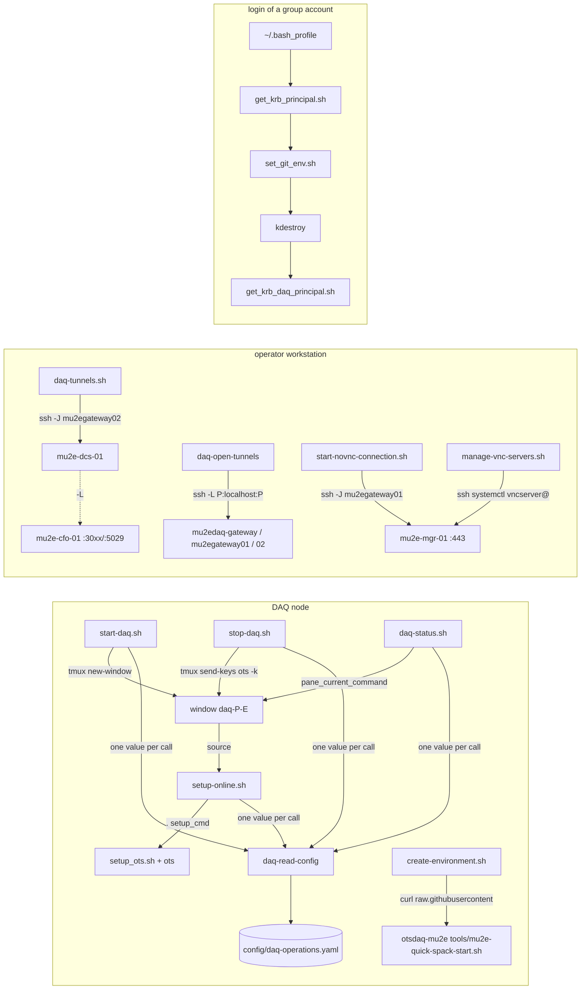

# mu2edaq-shifter-tools

> Operator command-line toolkit for the Mu2e DAQ: tmux-based start, stop and status of otsdaq partitions, SSH tunnel and noVNC access to the control room, parallel cluster file copy, and the Kerberos/git login environment for shared shifter accounts

| | |
|---|---|
| Repository | `Mu2e/mu2edaq-shifter-tools` (public) |
| Language | bash (16 commands, 1 library) and Python 3.9 (5 console scripts) |
| Version | 1.1.0 (`pyproject.toml`, `__init__.py`, `CMakeLists.txt`; tag `t01.01.00`) |
| Ports | binds none as a service; opens SSH local forwards only (see [INTERFACES.md](INTERFACES.md#2-network-endpoints)) |
| Depends on | `otsdaq-mu2e` (fetches `tools/mu2e-quick-spack-start.sh`), `mu2edaq-cluster-tools` (`ssh-selector` alias); external otsdaq `ots`, tmux, ssh/Kerberos |
| Tests | 373 pytest cases (offline), not run by CI |
| Interfaces | [INTERFACES.md](INTERFACES.md) |

## Purpose

The commands a shifter or a DAQ expert types: bring an otsdaq partition up
or down inside tmux, report what is running, set up one environment in the
current shell, build a spack test release, reach the control-room GUIs and
noVNC desktops through SSH forwards, copy files to many nodes, and give
shared group accounts (`mu2eshift`, `mu2edaq`, ...) a per-person git
identity and a group Kerberos ticket at login. There is no daemon and no
compiled code; CMake exists for packaging and CTest.

## Architecture



The material below is the package's own architecture description,
retained verbatim apart from heading levels; review notes are marked.

This toolkit is operator tooling for the Mu2e DAQ. It contains no
compiled code and no long-running service: every piece is a command a
shifter or a script invokes.

### Two independent halves

The commands fall into two groups that share only the configuration
layer:

**Partition lifecycle** — run on the DAQ cluster and manage `otsdaq`
(`ots`) instances inside tmux: `start-daq.sh`, `stop-daq.sh`,
`daq-status.sh`, `setup-online.sh`, `create-environment.sh`,
`send-run-control-command.sh`, and `start-tmux.sh`. All but the last
read the operations YAML; `start-tmux.sh` only lays out panes and
needs nothing beyond tmux.

**Shifter workstation plumbing** — run wherever the operator is, and
reach the control room from outside it: `daq-tunnels.sh`,
`daq-open-tunnels`, `start-novnc-connection.sh`,
`manage-vnc-servers.sh`, `daq-cluster-cp`, `daq-network-verify.sh`, and
the Kerberos/git login scripts.

Only the YAML-reading commands need Python, and only because they read
it through `daq-read-config`. The second group's shell commands need
nothing but `bash` and `ssh`, which is a property worth preserving —
see [CONFIGURATION.md](CONFIGURATION.md#yaml-or-environment).
(`daq-open-tunnels` and `daq-cluster-cp` are Python by nature and are
the exception in that group.)

### The configuration layer

```
                  command line
                       |
                  environment
                       |
                    .env files
                       |
                   config file
                       |
                    default
                       |
        +--------------+--------------+
        |                             |
  daq-common.sh              mu2edaq_shifter_tools.config
   (shell commands)              (Python commands)
        |                             |
        +----------> daq-read-config <-+
                          |
                 config/daq-operations.yaml
```

`daq-common.sh` and `mu2edaq_shifter_tools.config` are deliberate
mirrors of each other: the same precedence, the same search path, the
same root discovery. A shell command and a Python command therefore
resolve any setting identically.

#### No shell script parses YAML

The shell commands do not read the operations file. They call
`daq-read-config` once per value, selecting it with a *command verb*:

```sh
daq-read-config -z partition_0 active-envs
daq-read-config -z partition_0 -e tracker directory
```

The consequence for maintenance is the one thing to remember about this
codebase: **adding a configuration field means adding a verb to
`read_config.py`**, not adding a parser to a script. `VERBS` in that
module is the single source of truth for the list, and
`daq-read-config --list-verbs` prints it.

Text output from that tool is bare — no labels, no quoting — because
callers capture it with command substitution, and a list is printed
space-separated on one line because the callers' `for` loops expect
that. `tests/test_read_config.py` asserts the exact output shape for
this reason.

#### `daq-common.sh`

Sourced by every operator command that has settings to resolve. The
partition-lifecycle and tunnel commands depend on it outright; the VNC
and login scripts source it optionally, for the `.env` tier, and still
run without it. Only the two setup scripts and `get_krb_principal.sh`,
which has no settings, leave it alone. It replaced four verbatim copies
of an artdaq-style `expr`-based option parser, which is where several
of the bugs fixed in v1.1.0 were hiding.

It provides root discovery, `.env` loading, the config search,
interpreter discovery, `daq-read-config` invocation, `<COMMAND>_OPTS`
expansion, `Pass`/`Fail` reporting and a confirmation helper. Full API
in `daq-common.sh(3)`.

Scripts locate it by looking next to themselves, then in `scripts/`,
then in `~/bin` — which covers running from a checkout, running a
top-level command, and running an installed copy.

### The DAQ start/stop model

`start-daq.sh` creates one tmux session per partition, `daq-<partition>`:

```
session daq-partition_0
  window partition_0-main              a plain shell for the operator
  window daq-partition_0-tracker       source setup-online.sh; ots; exec bash
  window daq-partition_0-trigger       source setup-online.sh; ots; exec bash
```

Windows are **named**, and `stop-daq.sh` and `daq-status.sh` address
them by name. The original scripts addressed them positionally
(`daq-$partition:$ii`, re-deriving `$ii` from `active-envs`), which
meant `kill_daq` sent `ots -k` to the wrong window whenever the two
orderings disagreed. Naming removes the coupling entirely.

`ots` is followed by `exec bash` so the window survives for inspection
after `ots` exits.

`stop-daq.sh` sends `ots -k` into each window, then polls
`pane_current_command` until no pane is running `ots`, and only then
kills the session. `--kill-session` skips the wait.

`setup-online.sh` **must be sourced**: it changes directory and defines
the ots environment in the caller's shell. The login aliases define
`setup_online` as exactly that. It unsets all of its own variables
before returning, so the ots environment is the only thing it leaves
behind.

### Kerberos and git bootstrap

The installed `~/.bash_profile` runs four steps, and **the order is
load-bearing**:

```
1. get_krb_principal.sh       KRB5_PRINCIPAL <- the human's login ticket
2. set_git_env.sh             git identity + GIT_SSH_COMMAND from it
3. kdestroy                   drop the human's ticket
4. get_krb_daq_principal.sh   kinit -kt the group account's keytab
```

Why each step is where it is:

- Steps 1–2 run **before** step 4 so the git identity comes from the
  individual, not the group account. Commits made from a shared
  `mu2eshift` account are still attributed to the person who made them.
- Step 3 runs **after** step 2 so that once the git environment is set
  up, the human's credentials are no longer available to anything
  running as the group account.
- Step 4 runs **last** because it needs step 3 to have cleared the
  cache.

Moving step 4 earlier would attribute every commit to the group
account. Dropping step 3 would leave the human's ticket exposed.

> **Review note (2026-10-06).** Step 2 writes `git config --global`, i.e. the
> group account's single `~/.gitconfig` (`scripts/set_git_env.sh:48,90-91`).
> With two people logged in to the same account, every shell uses whichever
> identity was written last, so attribution holds only for one concurrent
> login per account. mu2edaq-operations' `check_keys.sh` periodically unsets
> these keys (Mu2e/daq-operations#47). Staged as ST-004.

`login/bashrc` additionally rewrites `KRB5CCNAME` to a randomised path
whenever the credential cache is the shared group-account one, so
shifters on the same node do not end up sharing credentials. Valid
group principals are listed in `data/mu2e_kerberos_principals.json`.

The identity is always derived from the keytab or ticket, never
hardcoded, so one set of dotfiles serves every account.

### Deployment layout

`install-login.sh` defines what "installed" means:

```
login/*          ->  ~/.<name>          mode 644
scripts/*        ->  ~/bin/<name>       mode 755
start-daq.sh     ->  ~/bin/start-daq.sh
stop-daq.sh      ->  ~/bin/stop-daq.sh
MU2EDAQ_ROOT     ->  ~/.mu2edaq/env
```

So **`scripts/` is the directory whose contents land on the `PATH`**. A
helper that shifters should be able to invoke by name belongs there.

The recorded `MU2EDAQ_ROOT` closes the one gap in root discovery: a
command sitting in `~/bin` cannot find `config/` and `data/` by walking
up from itself. It is written as a `.env` file rather than exported
from a dotfile so that it ranks below the real environment and can
still be overridden.

### Port allocation

Three unrelated schemes coexist. Check which applies before changing a
port.

| Scheme | Used by | Rule |
|---|---|---|
| uid-derived | `daq-open-tunnels` | local port = `uid + 973` + per-entry offset; keeps concurrent users apart with no coordination |
| service table | `daq-tunnels.sh` | fixed per-service base ports plus a caller-supplied `--offset`; a `!` marks a port that takes no offset |
| ots offsets | the DAQ itself | `ots_port_offset` + per-environment `port_offset`; exposed as the `gateway-port` verb |

> **Review note.** In both tunnel commands the remote port equals the local
> port (`-L P:host:P`), so for `daq-open-tunnels` the far-end service must
> listen on the operator's uid-derived port.

### Tunnel process tracking

Both tunnel commands record the pid of each `ssh` they start, and stop
exactly those pids.

For `daq-tunnels.sh` this replaced `pkill -f "ssh.*mu2e-"`, which also
matched the operator's own interactive ssh sessions to any Mu2e host,
and any unrelated tunnel to a Mu2e machine. Pattern matching survives
as `--all-matching` for when the state file has been lost, but it is
no longer what `stop` does by default.

`daq-tunnels.sh` opens two ssh processes rather than one, so that a
single unavailable forward — which `ExitOnForwardFailure` turns into a
dead ssh — cannot take the other group down with it.

### Not implemented

**`send-run-control-command.sh`** has complete option handling,
configuration resolution and port calculation, and is covered by the
tests, but exits 3: the otsdaq gateway supervisor's UDP payload format
has not been transcribed. The file says so, and carries notes on what
is needed. Use the otsdaq web GUI through the forwards from
`daq-tunnels.sh` instead.

**ResourceManager** does not exist. It was sketched in the original
README and the design is recorded below, so the intent is not lost.
The empty placeholder file it had was removed in v1.1.0.

> **Review note (2026-10-06).** A ResourceManager does exist in the
> superproject: `mu2edaq-resource-manager`, an advisory HTTP service on
> 8080 that no DAQ component calls (see its `docs/INTERFACES.md`). Nothing
> listens on the 1973 reserved below. Tracked by that review's staged RM-008.

#### ResourceManager design sketch

The problem it addresses: nothing currently prevents two DAQ partitions
from claiming the same DTC, or from choosing overlapping ports.

The sketch was:

- a **ResourceManager** reading a static inventory of available
  resources (DTCs and similar) and tracking which active partition has
  claimed each one, with `claim` / `release` / `status` /
  `transaction_{start,end}` operations
- a **ResourceSupervisor** inside each ots instance, talking to the
  ResourceManager to reserve fungible resources
- transaction semantics: any failure within a transaction makes every
  subsequent call in it fail until the transaction ends, which puts the
  ots state machines into their `failed` state

`resource_manager_port` (default 1973) is already reserved for it in
the operations YAML, and `daq-read-config resource-manager-port`
returns it.

### Repository conventions

- Remote is `Mu2e/mu2edaq-shifter-tools`, public.
- CI runs the Mu2e reusable `git-whitespace` and
  `mu2e-format-single-pkg` workflows on every push and PR to `main`.
  **Trailing whitespace fails the build.**
- Tags use a `tNN.NN.NN` form (`t01.00.00`).
- Python is `black`-formatted. No linter is configured, by choice.
- Anything that touches a live host gets `--dry-run`; anything that can
  interrupt data taking gets `--yes` and a confirmation prompt.

> **Review note.** Those two workflows check whitespace and run clang-format
> and black on changed files; the other two only add issues and PRs to
> org project 6. None runs pytest or CTest. Staged as ST-010.

## Interfaces

See [INTERFACES.md](INTERFACES.md): command-line contracts and exit codes,
every network endpoint the commands reach, the files written into an
account, the `daq-read-config` verb table, and the gateway each tunnel uses.

## Configuration

Precedence everywhere: command line > environment > `.env` > config file >
default, implemented twice (`scripts/daq-common.sh`,
`src/mu2edaq_shifter_tools/config.py`). Files: `config/daq-operations.yaml`
(symlink to the example), `config/tunnels.yaml` (symlink to the example),
`config/current_release.yaml` (gitignored), `.env`, `~/.mu2edaq/env`.
Formats are in `daq-operations.yaml(5)`, `tunnels.yaml(5)`,
`current_release.yaml(5)` and `docs/CONFIGURATION.md`.

## Operations

No service. Install per account with `install-login.sh` (see
[INSTALL.md](INSTALL.md)); run `start-daq.sh`/`stop-daq.sh`/`daq-status.sh`
on the DAQ node and the tunnel/VNC commands on the operator's machine.
`OPERATIONS.md` is not provided because nothing runs unattended.

## Interactions with other packages

| Package | How | Evidence |
|---|---|---|
| `otsdaq-mu2e` | `create-environment.sh` downloads and executes `tools/mu2e-quick-spack-start.sh` from the `develop` branch over HTTPS | `scripts/create-environment.sh:117-120` |
| otsdaq / `otsdaq-mu2e-config` `setup_ots.sh` | `setup-online.sh` sources the environment's `setup_cmd` (a test-release `setup_ots.sh <subsystem>`); `start-daq.sh` then runs `ots`, `stop-daq.sh` sends `ots -k` | `scripts/setup-online.sh:156`, `start-daq.sh:134`, `stop-daq.sh:128` |
| `mu2edaq-cluster-tools` | `login/aliases` defines `sshx`/`nodes` as `ssh-selector -c ~/config/mu2e_daq.yaml`; neither package installs that config path | `login/aliases:13-14` |
| `mu2edaq-resource-manager` | none. `resource_manager_port: 1973` is read only by `daq-read-config resource-manager-port`; nothing connects, and the service binds 8080 (`mu2edaq-resource-manager/docs/INTERFACES.md` §1.2, staged RM-008) | `src/mu2edaq_shifter_tools/config.py:432-434` |
| `mu2edaq-operations` | none in code. Conflicting policy: `scripts/set_git_env.sh` writes `git config --global` identities into shared accounts; operations' `check_keys.sh` unsets them and its `ops_setup_ots.sh` deliberately avoids `--global` | `scripts/set_git_env.sh:48,90-91` |
| `Bootstrap` | overlap, not dependency: both ship `~/.bashrc`/`~/.bash_profile` and an ssh client configuration for the same hosts | `install-login.sh:111-115`, `config/ssh-config-mu2e.example` |
| `mu2edaq-discovery` | not used | — |

No Python import of any other `mu2edaq-*` package: runtime dependencies are
PyYAML and click (PyQt5 optional, pytest for tests) — `pyproject.toml:27-34`.

## Review findings

Staged in [ISSUES-PENDING.md](ISSUES-PENDING.md) for `Mu2e/mu2edaq-shifter-tools`
(no issues exist on the remote, so nothing is deduplicated against it).
Summary, highest first:

| ID | Sev | Finding |
|---|---|---|
| ST-001 | S3 | `daq-tunnels.sh restart` always runs as a dry run and exits 0 (`${dry_run:+-n}` with dry_run=0) |
| ST-002 | S3 | `create-environment.sh` exits 0 when the download or the spack helper fails; its man page said 1 |
| ST-003 | S3 | `stop-daq.sh` sends `ots -k` only to `active_environments` windows; `start-daq.sh -e` windows are SIGHUP-killed after the timeout |
| ST-004 | S3 | `set_git_env.sh` writes per-person identity into the shared account's `~/.gitconfig`; concurrent logins mis-attribute; conflicts with daq-operations `check_keys.sh` |
| ST-005 | S3 | `data/daq_nodes.json` (used by `daq-cluster-cp`) names `mu2etrkNN`/`mu2ecaloNN`/`mu2ecrvNN`, not the MC-2 `mu2e-trk-NN` nodes; 30/38 names did not resolve |
| ST-006 | S3 | `config/ssh-config-mu2e.example`: `Host mu2e-*` first-match routes every MC-2/MC-1 host via the HEERC `mu2edaq-gateway`; ships `StrictHostKeyChecking no` and `ForwardAgent` for all hosts |
| ST-007 | S3 | `daq-operations.example.yaml` passes `calorimeter` to `setup_ots.sh`, which accepts only `calo` |
| ST-008 | S3 | `daq-tunnels.sh` service table (`trig=3045`, `stm=30351`) disagrees with every `setup_ots.sh` port table |
| ST-009 | S3 | `login/bashrc` shared-cache detection hard-codes uid 51937 and `/tmp/krb5cc_55438` |
| ST-010 | S3 | 373 tests, no CI job runs them |
| ST-011 | S3 | `tunnels.example.yaml` gives gateway01 and gateway02 the same offset; only one binds |
| ST-012 | S4 | `send-run-control-command.sh` is a stub: clear refusal, exit 3 (informational lines on stdout) |
| ST-013 | S4 | `daq-network-verify.sh` prints only section headers; host lines go only to the file |
| ST-014 | S4 | `login/aliases` `sshx`/`nodes` point at `~/config/mu2e_daq.yaml`, installed by nothing; `login/bashrc` ships a personal `ejc()` git-identity function |
| (RM-008) | S3 | add to the resource-manager review's staged issue: `resource_manager_port: 1973` is unused here and nothing listens on it |

**send-run-control-command.sh verdict.** A real invocation prints
`Target: localhost:10010 (partition_0/tracker)` and `Command: start` on
stdout, two "not implemented" lines on stderr, and exits 3; `-n` exits 0
with "Dry run: no datagram sent (payload format not implemented)". This is
a clear refusal, not apparent success (S4).

**OTS :8443.** None of the tunnels reaches port 8443 on either gateway.
`daq-tunnels.sh` uses `mu2egateway02` only as a ProxyJump to `mu2e-dcs-01`
and forwards the otsdaq GUIs from `mu2e-cfo-01` on ports 30xx/5029;
`tunnels.yaml` forwards uid-derived ports on each gateway's own loopback.
The tunnels therefore provide no evidence for either side of the
gateway01/gateway02 :8443 dispute in the shifter documentation.

## See also

- [INSTALL.md](INSTALL.md) — deployment
- [BUILD.md](BUILD.md) — build, test, and how to extend the toolkit
- [CONFIGURATION.md](CONFIGURATION.md) — every setting and its precedence
